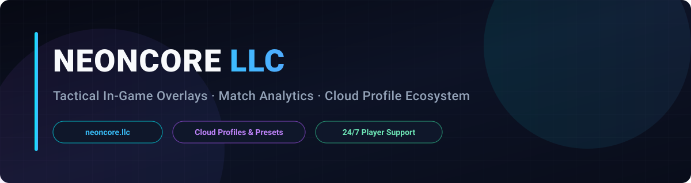

 

---

## О платформе NeonCore / About NeonCore LLC

**NeonCore LLC** разрабатывает экосистему тактических игровых оверлеев, аналитики матчей и облачных профилей настройки для соревновательных и кооперативных игр. Все продукты управляются через единый каталог профилей и настраиваются непосредственно в игровом меню.

---

## Каталог продуктов и руководство по использованию / Product Suite & Usage

### 1. NeonCore — Age of Empires IV & RTSLytics
- **Что делает функция:** Отображает на экране тактическую сводку по экономике, очередям производства, таймерам эпох и ключевым событиям на карте, автоматизирует базовые рутинные макро-действия и предоставляет послематчевый разбор реплеев, билд-ордеров и меты.
- **Как её использовать:** Выберите профиль **Age of Empires IV** в каталоге клиента, откройте внутриигровое меню по горячей клавише, включите нужные информационные панели на экране и настройте ползунки масштаба интерфейса или выберите готовый пресет. Для просмотра статистики матчей перейдите в раздел аналитики на портале [neoncore.llc](https://neoncore.llc).

### 2. NeonCore — Path of Exile 1 & Path of Exile 2
- **Что делает функция:** Показывает полезные визуальные индикаторы опасных модификаторов, радиусов умений, ценных предметов и состояния здоровья/ресурсов персонажа, а также автоматизирует использование защитных флаконов и реакций при критических порогах.
- **Как её использовать:** Активируйте профиль **Path of Exile** или **Path of Exile 2** перед запуском, откройте меню настроек в игре, отметьте нужные визуальные индикаторы и задайте пороговые значения ползунков и горячие клавиши для автоматического срабатывания.

### 3. NeonCore — Dota 2
- **Что делает функция:** Выводит на экран наглядные индикаторы радиусов способностей, таймеров возрождения объектов, перезарядок умений и предметов соперников, помогая контролировать темп карты и командные сражения.
- **Как её использовать:** Включите нужные виджеты в разделе **Визуализация** и **Таймеры** внутриигрового меню, настройте удобные горячие клавиши для быстрого переключения слоёв и сохраните конфигурацию в свой облачный профиль.

### 4. NeonCore — Deadlock
- **Что делает функция:** Отображает тактические маркеры позиционирования, состояния здоровья, дистанции применения умений и таймингов ключевых объектов на линиях, упрощая ориентацию в динамичных боях.
- **Как её использовать:** Откройте меню настройки в матче, включите отображение тактических рамок и индикаторов дистанции, отрегулируйте прозрачность и цветовую схему ползунками и назначьте клавишу быстрого включения.

### 5. NeonCore — Minecraft
- **Что делает функция:** Подсвечивает полезные игровые объекты, блоки и ориентиры в окружающем мире, а также автоматизирует вспомогательные действия передвижения и инвентаря.
- **Как её использовать:** Откройте модульное меню по назначенной горячей клавише, активируйте нужные категории подсветки или помощников, настройте дальность отображения ползунком и сохраните выбранный профиль.

---

## Быстрый старт / Quick Start

1. **Выбор продукта:** Перейдите в каталог [neoncore.llc/products](https://neoncore.llc/products) и выберите нужную игру и тарифный план.
2. **Активация профиля:** Запустите клиент, выберите активную подписку и загрузите рекомендованный облачный пресет.
3. **Настройка в игре:** Используйте внутриигровое меню для включения нужных индикаторов, назначения горячих клавиш и регулировки ползунков под свой стиль игры.

---

## Поддержка и контакты / Support & Resources

- **Официальный портал:** [https://neoncore.llc](https://neoncore.llc)
- **Каталог продуктов и статусы:** [https://neoncore.llc/products](https://neoncore.llc/products)
- **Служба поддержки:** [support@neoncore.llc](mailto:support@neoncore.llc)
- **Политика безопасности:** [SECURITY.md](https://github.com/neoncore-llc/.github/blob/main/SECURITY.md)
